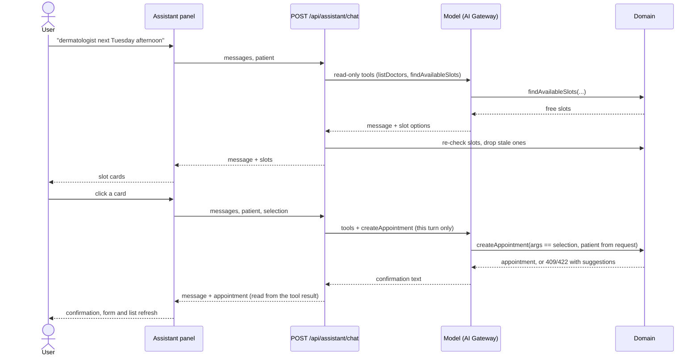

# Clinic Booking

Book medical appointments without double-booking, through a form or a chat assistant that finds real free slots and
books the one you pick.

[](../../actions/workflows/ci.yml)
[](../../actions/workflows/docker.yml)

## What it does

- **Form booking with overlap prevention**: a doctor can't be booked twice for the same time, and neither can a patient
  (across all doctors). Back-to-back appointments are fine.
- **Availability**: pick a doctor, date and duration and the free slots show up as chips.
- **Conflict suggestions**: when a time is taken, the API answers `409` with the next free slots, shown as one-click
  alternatives.
- **AI assistant**: ask "dermatologist next Tuesday afternoon", get slot cards built from real availability, click one
  and the assistant books it through the same domain logic as the form.
- **One-command setup**: `docker compose up` runs migrations, seeds four doctors and serves the app.

## Quick start (Docker)

```bash
cp .env.example .env    # optional: add AI_GATEWAY_API_KEY to enable the assistant
docker compose up --build
# → http://localhost:8080
```

Without a key the app works the same, minus the assistant panel. Data lives in the `db-data` volume; `docker compose
down -v` resets it.

## Local development

Prerequisites: **Node 24** and **pnpm 12** (`corepack enable` or `npm i -g pnpm@12`).

```bash
pnpm install
cp .env.example .env    # optional, same as above
pnpm dev
```

- Frontend on http://localhost:5173, API on http://localhost:3000. Vite proxies `/api` to the backend, so open the
  frontend URL.
- The backend applies migrations and seeds on start (SQLite file at `backend/data/app.db`); delete that file to start
  over.

| Script | What it does |
|---|---|
| `pnpm dev` | Backend (`tsx watch`) and frontend (Vite) in parallel |
| `pnpm lint` | `biome check .` (lint + format + import order) |
| `pnpm lint:fix` | Same, applying safe fixes |
| `pnpm typecheck` | `tsc` in both packages |
| `pnpm test` | Vitest in both packages |
| `pnpm build` | Backend bundle (tsdown) and frontend bundle (Vite) |
| `pnpm --filter backend db:generate` | Generate a SQL migration after editing `backend/src/db/schema.ts` |

## Configuration

Backend environment variables. In Docker they come from `.env` (optional); locally, `pnpm dev` loads the root `.env` too.

| Variable | Default | Notes |
|---|---|---|
| `PORT` | `3000` | API port |
| `DATABASE_URL` | `./data/app.db` (Docker: `/data/app.db`) | SQLite file path, relative to `backend/` |
| `MIGRATIONS_DIR` | `<cwd>/drizzle` (Docker: `/app/drizzle`) | Folder with the committed SQL migrations |
| `CLINIC_TIMEZONE` | `America/Argentina/Buenos_Aires` | IANA zone for working hours, slot generation and input times |
| `AI_GATEWAY_API_KEY` | _(empty)_ | Vercel AI Gateway key. Empty disables the assistant (`503`, panel hidden) |
| `AI_MODEL` | `anthropic/claude-haiku-5.5` | Any AI Gateway model id |
| `LOG_LEVEL` | `info` | `fatal` … `trace`, or `silent` |

## Architecture

```
.
├─ backend/                 Fastify API
│  ├─ src/
│  │  ├─ domain/            time, availability, appointments (the only write path), errors
│  │  ├─ routes/            health, config, doctors, appointments, assistant
│  │  ├─ ai/                assistant (generateText), tools, prompt, schemas
│  │  └─ db/                Drizzle schema, client, migrations, seed
│  └─ drizzle/              generated SQL migrations (committed)
├─ frontend/                Vite + React SPA
│  └─ src/
│     ├─ features/          booking/ (form, slot chips, list), assistant/ (chat panel)
│     ├─ lib/               API client, TanStack Query hooks, formatting
│     └─ components/ui/     shadcn/ui (generated)
├─ docs/                    PLAN.md (design contract) and specs/
├─ .github/workflows/       ci.yml, docker.yml
└─ docker-compose.yml       migrate → api → web
```

**Request flow.** Browser → nginx (`web`, serves the SPA, proxies `/api`) → Fastify (`api`, zod-validated routes) →
domain functions → SQLite. In development Vite plays nginx's role. In Docker a one-shot `migrate` service applies
migrations and seeds before `api` starts, and `web` waits for `api` to be healthy.

**API** (all under `/api`): `GET /health`, `GET /config`, `GET /doctors`, `GET /doctors/:id/availability?date&duration`,
`GET /appointments`, `POST /appointments`, `POST /appointments/:id/cancel`, `POST /assistant/chat`. Details in
[`docs/PLAN.md`](docs/PLAN.md#api-api).

**Assistant flow.** The chat endpoint is stateless: the client sends the recent history every turn.



## Design decisions

- **Fastify + `fastify-type-provider-zod`**: zod schemas validate requests and serialize responses and give the handler
  types, from one definition. `app.inject()` makes route tests fast with no server running.
- **Drizzle + SQLite (better-sqlite3)**: zero-ops storage with committed SQL migrations. better-sqlite3 is synchronous,
  so the overlap check and the insert run inside one `IMMEDIATE` transaction that takes the write lock up front: two
  concurrent requests can't both see a slot as free.
- **Overlap rule**: intervals are half-open, so two appointments overlap when `a.start < b.end && a.end > b.start`, and
  10:00–10:30 followed by 10:30–11:00 is allowed. The same check runs per doctor and per patient (by email, across
  doctors), since a person can't be in two rooms at once.
- **Clinic-local input, UTC storage**: the API takes `date` + `startTime` in the clinic's time zone (that's how people
  think about appointments), converts to UTC once in `domain/time.ts`, stores epoch ms and returns ISO UTC. The
  frontend formats in the clinic zone from `/api/config`, so a browser in another zone still sees clinic times.
- **One write path**: `createAppointment()` in `backend/src/domain` is called by both `POST /appointments` and the
  assistant's tool, so every rule applies to both and can't drift.
- **AI guards**: the server never trusts the model.
  - The booking tool is only offered on a turn where the user clicked a slot (`selection` in the request).
  - The tool rejects arguments that differ from that selection.
  - Patient name and email come from the request, never from model arguments.
  - "Booked" is read from the tool's actual result, not from the model's text; returned slots are re-checked too.
- **TanStack Query + TanStack Form, no router**: Query owns server state and invalidation after writes, Form owns form
  state with zod validators. That covers all state, so no global store. It's one page, so no router.
- **Biome**: one tool and one root config for linting, formatting and import order in both packages.
- **pnpm `minimumReleaseAge: 2880`**: versions published in the last two days are never installed, which keeps a
  freshly compromised release out of the lockfile.

## Testing

```bash
pnpm test                          # everything
pnpm --filter backend test         # one package
```

- **Backend** (Vitest): time conversion and overlap edge cases (touching, contained, partial); slot generation against
  working hours, existing appointments and "now"; the appointment routes via `app.inject()` on in-memory SQLite with the
  real migrations (201, doctor and patient 409 with suggestions, 422 outside hours, cancel frees the slot); the
  assistant with the AI SDK mock model (a selection turn books, mismatched args are rejected, no booking tool without a
  selection, a taken slot returns suggestions, stale slots are dropped, no key gives 503, model errors give 502).
- **Frontend** (Vitest + Testing Library + jsdom): booking form validation and the 409 conflict with suggestion chips;
  assistant panel slot cards, the selection request on click and the confirmation.

Not covered: end-to-end browser tests and a compose smoke test in CI.

## CI/CD

- **`ci.yml`** (pull requests and pushes to `main`): frozen install, `biome ci`, typecheck, test, build.
- **`docker.yml`** (`v*` tags only): builds both images for `linux/amd64` and `linux/arm64`, each on a native runner
  (no emulation), merges them into one multi-arch manifest per tag and publishes it to GHCR with the built-in
  `GITHUB_TOKEN`. It doesn't wait for CI, so tag a commit on `main` that's already green.

| Image | |
|---|---|
| `ghcr.io/<owner>/<repo>-backend` | API (also runs `node dist/migrate.js` for migrations + seed) |
| `ghcr.io/<owner>/<repo>-frontend` | nginx serving the SPA and proxying `/api` to `api:3000` |

| Tag | When |
|---|---|
| `X.Y.Z`, `X.Y`, `sha-<short>` | every `vX.Y.Z` tag |
| `latest` | every `vX.Y.Z` tag except pre-releases (`v1.2.0-rc.1`) |

To cut a release:

```bash
git tag v1.2.3
git push origin v1.2.3
```

GHCR packages start **private**. To pull without logging in, make each package public under the owner's
*Packages → Package settings*; otherwise `docker login ghcr.io` first.

## Limitations & roadmap

- No auth, roles or patient accounts; patients are identified by email.
- No doctor schedule or holiday management (Mon–Fri, fixed hours from the seed) and no recurring appointments.
- No notifications.
- No rate limiting or cost caps on the AI endpoint.
- The assistant doesn't stream and keeps no server-side history; the client sends recent turns, so earlier tool calls
  aren't visible to the model.
- Overlaps are prevented in the transaction, not by a DB-level constraint or trigger.
- The API contract is duplicated between backend schemas and the frontend client (no shared package or OpenAPI
  codegen).
- No E2E tests (Playwright) and no compose smoke test in CI.
- Images are published but not deployed anywhere.
- No i18n and no observability beyond request logs.
- The frontend ships as one ~585 kB (176 kB gzip) chunk; it could be split.
